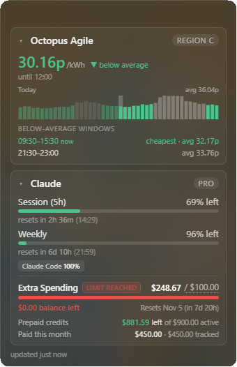

# desktop-dashboard

A lightweight, frosted-glass desktop widget (Tauri v2) made of independent boxes: live Claude Code usage
(session and weekly quota remaining, with reset countdowns, spending and prepaid credits) and today's Octopus Agile electricity prices.

<p align="center"></p>

## How it works

- Reads the OAuth token Claude Code stores in `~/.claude/.credentials.json` (login with `claude` first).
- Polls the same endpoint that powers Claude Code's `/usage` (`GET https://api.anthropic.com/api/oauth/usage`) every 5 minutes, with exponential backoff on rate limits (the endpoint is undocumented and strict about polling).
- Also shows today's (and, once published, tomorrow's) Octopus Agile half-hourly prices for region C (London; `REGION` in `octopus_agile.rs`) from the public Octopus API (no key): the current price, below-average windows, and a glowing "Paid to use" effect when the price is negative.
- Every block is its own box with a title row. **Click the title to collapse** the box to just its title (click again to expand), and **drag the title up or down to reorder** the boxes. Order and collapsed state are saved in `settings.json` and restored on launch.
- Frameless transparent window with Windows Acrylic blur; drag it anywhere by the header — position is remembered.

## Develop

```sh
npm install
npm run tauri dev
```

Rust unit tests: `cd src-tauri && cargo test`

## Build

```sh
npm run tauri build
```

## Adding a new stat card

Each stat is a provider (Rust) + card renderer (TS):

1. Add `src-tauri/src/providers/<name>.rs` implementing `StatProvider` (id, poll interval, `fetch()` returning normalized JSON), and register it in `providers::all()`.
2. Add `src/cards/<name>.ts` exporting a render function `(body, payload) => void`, and register it in the `CARDS` map in `src/main.ts` with a `title`, and optionally `meta` (small badge on the right of the title row, e.g. the plan or region) and `tick` (re-evaluate time-dependent text between polls).

Every card is drawn inside its own box by `src/card-frame.ts`, so unrelated blocks stay isolated and get collapse + drag-to-reorder for free. The box style is `.card` in `src/styles.css`. Your renderer only fills the box body: don't add an outer border, background or title row, and put state classes meant for the whole box (like `negative-price`) on `body.closest(".card")`. A new card appears at the end until the user moves it; the default order is `CARDS` order.

The Rust side polls each provider on its own schedule and emits `stats://<id>` events; the frontend renders whatever cards are registered.

## Deferred ideas

- **Remaining API funds** — blocked on Anthropic exposing a credit-balance endpoint ([feature request](https://github.com/anthropics/claude-code/issues/47574)); could be approximated with manual balance entry minus Admin API cost report.
- Autostart with Windows (`tauri-plugin-autostart`).
- Pin-to-desktop layer (behind other windows, Rainmeter-style).
