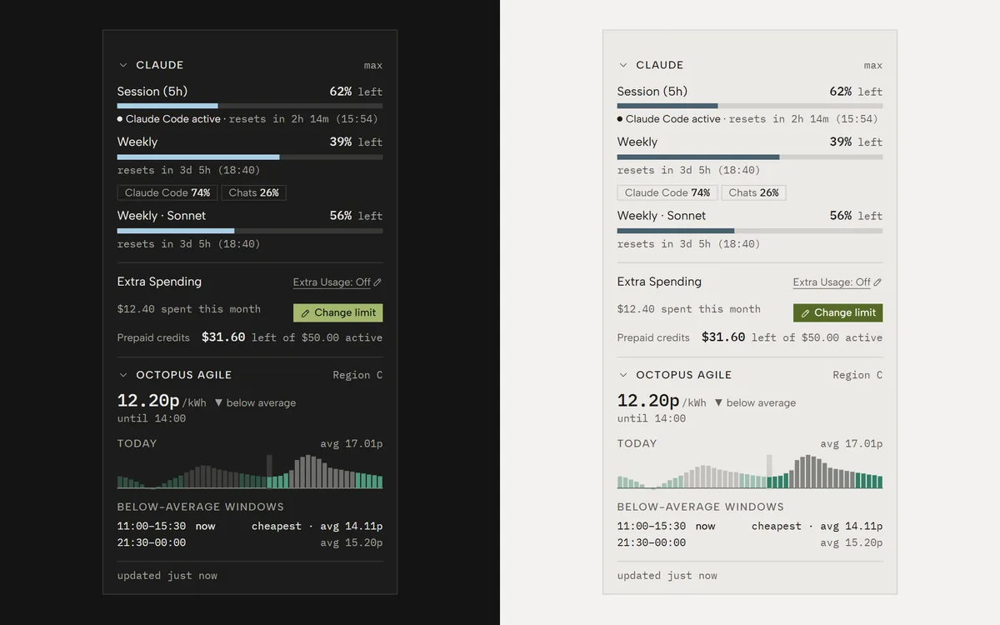

# desktop-dashboard



A small desktop widget (Tauri v2) made of independent sections: live Claude Code usage
(session and weekly quota remaining, with reset countdowns, spending and prepaid credits) and today's Octopus Agile electricity prices.

## How it works

- Reads the OAuth token Claude Code stores in `~/.claude/.credentials.json` (login with `claude` first).
- Polls the same endpoint that powers Claude Code's `/usage` (`GET https://api.anthropic.com/api/oauth/usage`) every 5 minutes, with exponential backoff on rate limits (the endpoint is undocumented and strict about polling).
- Also shows today's (and, once published, tomorrow's) Octopus Agile half-hourly prices for region C (London; `REGION` in `octopus_agile.rs`) from the public Octopus API (no key): the current price, below-average windows, and a "Paid to use" label with an edged section when the price is negative.
- The Claude box's **Extra Spending** row shows this month's usage credit spend, also while credits are off, and opens claude.ai's usage settings (see below).
- Every block is its own section with a title row. **Click the title to collapse** the box to just its title (click again to expand), and **drag the title up or down to reorder** the boxes. Order and collapsed state are saved in `settings.json` and restored on launch.
- Frameless window on a matte surface at 96% opacity; drag it anywhere by the header — position is remembered. Dark by default; light follows the system setting.

## Keeping usage credits off

Keep usage credits **off** by default: past the plan's session or weekly limit,
Claude waits for the reset instead of spending the balance, on every surface
(claude.ai, the Claude apps, Claude Duet, Claude Code). When a run is worth
pushing through, read this month's spend in the Extra Spending row, then click
**Change limit** (or the limit itself, or "Extra Usage: Off"; a pencil marks
what can be changed). claude.ai's usage page opens in your browser: switch
credits on and type the monthly limit you want under Adjust limit (for example
this month's spend plus the most you'll allow). Anthropic stops the spend at
that limit. The box reads the account again when you come back. The dashboard
only reads the account and never changes it, because there is no public
interface for that.

## Develop

```sh
npm install
npm run tauri dev
```

Rust unit tests: `cd src-tauri && cargo test`

### Demo mode

```sh
npm run demo
```

Serves the frontend at `http://localhost:1430` with invented data in place of the
Tauri IPC calls (`src/demo.ts`), so the UI renders in a plain browser. Open
`/docs/preview/preview.html` for both themes side by side, or `/?theme=light` for
one. The normal build leaves the demo code out.

The README image is made from that page by
[auto-generate-preview-image](https://github.com/yi-li-yang/auto-generate-preview-image):
run `auto-generate-preview-image capture` (spec in `preview.json`).

## Design

The look follows Yili Yang's visual system 1.0.0 (`DESIGN.md`; the token and font
files are copied into `src/vp/`). The accent is lichen and marks the one action,
**Change limit**. Data colours mark data only: quota bars go sky, ochre from 70%,
rust from 90%; cheap Agile half hours are spruce.

## Build

```sh
npm run tauri build
```

## Adding a new stat card

Each stat is a provider (Rust) + card renderer (TS):

1. Add `src-tauri/src/providers/<name>.rs` implementing `StatProvider` (id, poll interval, `fetch()` returning normalized JSON), and register it in `providers::all()`.
2. Add `src/cards/<name>.ts` exporting a render function `(body, payload) => void`, and register it in the `CARDS` map in `src/main.ts` with a `title`, and optionally `meta` (small badge on the right of the title row, e.g. the plan or region) and `tick` (re-evaluate time-dependent text between polls).

Every card is drawn inside its own section by `src/card-frame.ts`, so unrelated blocks stay isolated and get collapse + drag-to-reorder for free. The section style is `.card` in `src/styles.css`. Your renderer only fills the body: don't add an outer border, background or title row, and put state classes meant for the whole box (like `negative-price`) on `body.closest(".card")`. A new card appears at the end until the user moves it; the default order is `CARDS` order.

The Rust side polls each provider on its own schedule and emits `stats://<id>` events; the frontend renders whatever cards are registered. Frontend code reaches Rust only through `src/ipc.ts`; give a new command a demo answer in `src/demo.ts`.

## Deferred ideas

- **Remaining API funds** — blocked on Anthropic exposing a credit-balance endpoint ([feature request](https://github.com/anthropics/claude-code/issues/47574)); could be approximated with manual balance entry minus Admin API cost report.
- Autostart with Windows (`tauri-plugin-autostart`).
- Pin-to-desktop layer (behind other windows, Rainmeter-style).
